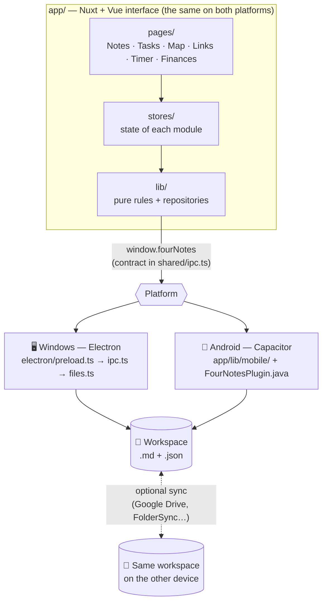
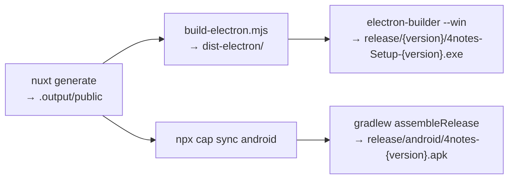

<div align="center">


# 4notes

**Notes, tasks, mind maps, links, a timer and expenses in a single app — 100% local, on your computer and on your phone.**


[Features](#features) ·
[Architecture](#architecture) ·
[Getting started](#getting-started) ·
[Builds](#builds) ·
[Mobile](#mobile) ·
[Shortcuts](#shortcuts) ·
[Detailed architecture](docs/ARQUITETURA.md)

</div>

---

## 💡 About

4notes is a personal organization app inspired by Windows Notepad, Obsidian, Capacities and Notion. It brings together, in a single interface, the things that usually end up scattered across several apps: quick notes, recurring tasks, idea maps, saved links, a log of the time spent on each activity and your expenses.

What sets it apart:

- **Your data are your own files.** No login, no server, no database. Everything lives in a **workspace** — a folder you create and name — as **Markdown** (`.md`) and **JSON**. Backing up means copying the folder; the files open in VS Code, Obsidian or Notepad.
- **An editor that hides the Markdown.** You only see the formatted text — headings, lists, checklists, colors, highlighted code blocks, images — and never the `**`, `#` or ` ``` ` fences. The file is still plain Markdown.
- **The same interface on Windows and Android.** There is a single interface codebase; only the layer that talks to the operating system changes. With the folder synced (Google Drive, for example), notes, tasks, maps and settings are the same on both devices.
- **Modules connected only where it makes sense.** Each module is independent; what links them is **mentions** (`@`), which work across all of them, and **shared categories**: the same "Study" category can organize notes, links, tasks, Timer sessions and expenses.

> [!NOTE]
> The app's interface is in Brazilian Portuguese. Menu items, buttons and settings are written below exactly as they appear in the app, with an English translation in parentheses where it helps.

---

<a id="features"></a>

## ✨ Features

### The six modules

| | Module | In short |
| :-: | --- | --- |
| 📝 | **Notes** (_Notas_) | Quick notes in tabs, categories with a color, icon or photo, automatic folders by title, newest notes on top, navigation between versions, TXT/PDF export. |
| ✅ | **Tasks** (_Tarefas_) | Categories (with their app-wide icon or photo), dates, recurrence (that works with the app closed), quick creation and a description with the same formatting as notes. |
| 🧠 | **Mind Map** (_Mapa Mental_) | Multiple maps; each node is a permanent note. Connections by dragging, multi-note selection and a "Reorganize" (_Reorganizar_) that avoids crossings. |
| 🔗 | **Links** | Paste an address and the site's title and icon arrive on their own. Categories, search and import of browser bookmarks. |
| ⏱️ | **Timer** | Stopwatch, countdown timer and Pomodoro, with a filterable history and statistics with charts and period comparison. |
| 💰 | **Finances** (_Finanças_) | Expenses and income, automatic categories, bills with a payment reminder, recurring entries (rent, subscriptions, salary), realized and projected balance, bank statement import (CSV/OFX), optional bank connection (Meu Pluggy, Open Finance), and a dashboard with charts and period comparison. |

Modules can be **enabled, disabled and reordered** (by dragging in the side menu). Disabling only removes the module from the menu: no data is deleted.

<details>
<summary><b>📝 Notes — details</b></summary>

<br>

- **Compact tabs** with horizontal scrolling (the thin bar at the top only shows up when the tabs don't fit); the active tab takes the color of the note's category.
- **Temporary and fixed tabs**: a single click in the list opens the note in a **temporary tab** (title in italics), which the next single click reuses for another note. A double click (in the list or on the tab), **Abrir em aba fixa** (_Open in a fixed tab_) in the context menu, or simply editing the note turns it into a **fixed tab**, which is never replaced. A note that is already open is only selected, and pending changes are saved before a temporary tab changes notes.
- **Automatic title**: the first line is the title, and the file name follows the title (`Game ideas.md`). By default, the first line of a new note already starts as a heading; **Título na primeira linha** (_Title on the first line_, in Settings › Modules › Notes) turns that off, and the first line starts as regular text — it still names the note.
- **Autosave** 0.6 s after the last keystroke, with atomic writes — also when closing the tab, with `Ctrl+S` and when closing the app.
- **Categories** are folders inside `notes/`, with a color, a built-in icon or a photo from the image library. Move notes through the context menu or by dragging. They are the app's **shared categories** (see below), so a category created in Tasks or Finances can become a notes folder too.
- **Newest on top**: the list shows the most recently changed notes first, also inside the folders (a folder counts by its newest note). **Pastas sempre no topo** (_Folders always on top_, in Settings › Modules › Notes, off by default) puts the folders before the notes at every level, whatever their date; the notes keep the newest-first order. Saved per workspace.
- **Folders by title** (only in the list; the files don't change): `4notes 1.1.1` and `4notes 1.2.0` show up as **4notes › 1.1.1, 1.2.0**. A folder's **+** creates a note that already starts with the folder's title, and its **clock** (or **Abrir a mais recente** — _Open the newest_ — in its context menu) opens the folder's newest note without having to look for it.
- **Automatic category by title** (optional, off by default): a new note goes on its own to the category that already has notes starting with the same title.
- **Versions**: in a note such as `4notes 1.4.1`, discreet buttons open the previous version (**‹ 1.4.0**) and the next one (**1.4.2 ›**), when they exist.
- **Code blocks like a code editor**: arrows in the margin **fold and unfold** objects, JSON, functions and nested blocks (languages without that information, such as GDScript, fold by indentation; folding only hides lines on screen), and subtle **indentation guides** show each level. The code font is slightly smaller, so long snippets fit better.
- **Format code**: after pasting code, the toast offers **Formatar** (_Format_), or **Escolher linguagem** (_Choose language_) when the language wasn't recognized. The ✦ button on the block, **Formatar** in full screen and `Shift+Alt+F` do the same. It uses Prettier (loaded only when you format, nothing leaves the device) for JavaScript, TypeScript, JSON, CSS, SCSS, LESS, HTML, Vue, YAML, Markdown and GraphQL, keeping the code's own style (indent size, quotes, semicolons). Code with a syntax error and languages without a safe formatter (Python, GDScript…) are left as they are; `Ctrl+Z` undoes it.
- **Full screen for blocks**: a text or code block opens in full screen from its card. **Quebrar linhas** (_Wrap lines_, button in the header or `Alt+Z`) fits long lines to the window width instead of scrolling sideways — only on screen: the block's content gets no real line breaks. In code, a wrapped line continues at its own indentation. Off by default for code and on for text (as before); the choice is remembered per workspace.
- **Export** from the context menu: **TXT** (text only, no formatting) or **PDF** (as it looks on screen, with images and highlighted code).
- Notes **without a category** ask, when you close the tab, whether you want to keep or delete them; notes in a category close right away, already saved.
- **Follow the open note in the list** (_Selecionar a nota aberta na lista_, Settings › Modules › Notes, on by default): switching tabs opens the folders down to the note and highlights it. Turned off, the list stays as you left it (folders and highlight only change when you click in the list).
- **Deleting a note** moves the file to the trash; once the **Undo** toast is gone, the library images that only that note used are removed too. Images still used anywhere else (another note, a map, a task, a Finances entry, a category photo) stay, and anything that can't be checked stays as well.

</details>

<details>
<summary><b>✅ Tasks — details</b></summary>

<br>

- **Quick creation**: `Estudar Godot amanhã #estudos` (_Study Godot tomorrow #studies_) already sets the date and the category.
- **Recurrence**: daily, weekly, every N days/weeks/months/years, counted from the scheduled date or from completion. A task stores only the rule and the next date — that's why it works with the app closed, with no background process.
- When completed, the next occurrence is calculated from today (missed ones are skipped); you can also **skip** an occurrence.
- **Pending** lists (Today and Overdue), **Scheduled** and **Completed**.
- **Formatted description** with the same editor as notes: bold, lists, checklists, code, pasted images and mentions (`@` items, `#` categories).
- Each task shows its **category icon** (or photo, or initial) from the app's central category list; changing the icon anywhere updates the tasks right away.
- The edit panel closes when you click outside it (without losing the draft of a new task).

</details>

<details>
<summary><b>🧠 Mind Map — details</b></summary>

<br>

- **Multiple maps**, each in a folder with one `.md` note per node and a `mapa.json` with the connections and colors.
- Nodes as **cards** (default) or **circles**, in the style of Obsidian's Graph View; drawn on a `<canvas>`, light even with hundreds of nodes.
- **Dragging** moves the note; **Shift + drag** creates a connection; dropping the arrow **on empty space** creates a new, already connected note.
- **Selecting multiple notes**: `Ctrl + drag` selects an area and `Ctrl + click` adds or removes a note. Move, color or delete the group at once, with a single **Undo**.
- **Reorganize the map**: a radial layout that minimizes crossings, shortens connections and keeps the map compact.
- On touch: pinch to zoom, a handle with an arrow to connect without Shift and long press for the menu.

</details>

<details>
<summary><b>🔗 Links — details</b></summary>

<br>

- **Save** by pasting in the field at the top, with `Ctrl+V` anywhere on the screen or by dragging a link from the browser. Duplicate links are detected by URL.
- **Title and icon** fetched automatically and stored in `links/icons/`, so they show up without internet.
- **Categories** with a color, icon or photo; sorting by **Recentes** (_Recent_), **A–Z** or **URL**.
- **Import from the browser**: Brave, Opera GX, Opera, Chrome, Edge, Vivaldi, **Firefox** and **Zen** are found automatically (one entry per profile). Other browsers: an HTML bookmarks file. Nothing is changed in the browser.
- A list ready for thousands of links (tested with 3,000).

</details>

<details>
<summary><b>⏱️ Timer — details</b></summary>

<br>

- **Stopwatch**, **countdown timer** (preset durations or `40`, `1:30`, `2h`) and **Pomodoro** with configurable focus, short break, long break and auto-start.
- Optional **category and activity** (e.g. category _Estudo_, activity _Estudando Godot_); recent activities restart with one click.
- **Time comes from the clock**, not from an on-screen counter: switching modules, minimizing or closing the app doesn't get in the way. A countdown that ends with the app closed is recorded at the right time.
- **History** with period, search, filters, grouping and editing of the valid time. Completed, interrupted and canceled sessions are told apart.
- **Statistics** with real data only: time per day, category and activity, a distribution donut, a days × hours heat map and a **comparison with the previous period** (for the current period, it compares the same stretch of both).
- Custom SVG charts, with no external library, readable in light mode, dark mode and on the phone.

</details>

<details>
<summary><b>💰 Finances: details</b></summary>

<br>

Three areas: **Lançamentos** (_Entries_: register, history, import), **Contas** (_Bills_) and **Painel** (_Dashboard_).

- **Quick entry**: choose **Gasto** (expense) or **Entrada** (income), type the amount and the description and press `Enter`; the date starts as today. Category and notes (_Observações_, collapsible, with the notes editor) are optional, in the same form. The amount accepts `52,30`, `52.30` or `1.234,56`, and is shown in Brazilian reais (`R$ 1.234,56`).
- **Automatic category**: the app picks, among the categories you already have, the one that fits: first what you did before with a similar description, then a dictionary of merchants and words (`iFood` goes to your food category, whether it is called "Alimentação", "Comida" or "Food"; Uber to transport; Netflix to subscriptions), then the **default category** (_Categoria padrão_, Settings › Modules › Finances). It applies when registering, importing a statement and fetching from the bank, is marked as "automática" and can be changed before saving. It never creates a category.
- **Bank connection** (optional, **Meu Pluggy**): connect your banks through Open Finance (you authorize in the bank's own app; 4notes never sees your password), add them in Settings › Modules › Finances › Conexões bancárias with your Pluggy Client ID/Secret (kept only on the device, encrypted by the system on Windows) and each bank's Item ID, and pick the accounts. **Buscar no banco** (_Fetch from the bank_) brings new transactions straight into the entries, with the automatic category, no duplicates (each one keeps its transaction id) and **Undo**; it also runs once a day when the app opens. Pending bank transactions wait for the next fetch, a card bill payment is skipped when the card is connected, and matching manual entries are linked instead of duplicated. Setup, costs and limitations: [docs/CONEXAO-BANCARIA.md](docs/CONEXAO-BANCARIA.md) (in Portuguese).
- **`#` categories**: `Feira #Mercado` in the description picks (or creates) the category and leaves `Feira` as the text; in the notes, `#` inserts a category mention linked by id.
- **Me lembre de pagar** (_Remind me to pay_): the expense stays **pending** until you confirm the payment, which records the day it was paid. States: pending, paid and overdue. With the app open, bills due today or overdue show a reminder (and, on Windows, a system notification), plus a badge on the module icon.
- **Recurring entries** (_Repetir_): daily, weekly, monthly or yearly, until you stop it or until a date. Occurrences up to today become real entries with their own id (recurrence + scheduled date, so reopening the app or syncing never duplicates them), date and status, and stay pending until confirmed; later ones are forecasts. Changing the amount, frequency or next date asks whether it applies to **the next one only** or **the next and future ones**; stopping or deleting keeps the payment history. Short months and leap years are handled from the first date (the 31st falls on the last day of shorter months).
- **Contas** (_Bills_): overdue and upcoming bills and income (stored and forecast, up to the end of the month, 30 or 90 days), the recurring entries and the payment history.
- **History** grouped by day (a paid bill counts on the day it was paid), with period, entry type, category, search and sorting; pending and overdue entries are marked and can be paid from the row, and forecast occurrences in the period show up separately. Clicking an entry opens it to edit, confirm or undo a payment, skip an occurrence, repeat today, see its mentions or delete it (with a confirmation and **Undo**).
- **Balance** (_Saldo_): the **realized** balance (an optional opening balance + income received − expenses paid, up to today; without an opening balance it is labeled as an estimate) and the **projected** balance (realized − pending, overdue and upcoming bills + expected income, up to the chosen date), plus received/paid in the period, committed amount and expected income.
- **Bank statement import** (CSV or OFX): delimiter, header row, columns (single signed amount, separate credit/debit or a D/C column), date order and decimal separator are detected and can be changed; Windows-1252 files are read correctly. Expense or income comes from the sign and the statement type (account or credit card). A preview lets you edit and select rows, suggests categories from similar descriptions or category names, leaves possible duplicates unchecked (same bank id, or same amount within 3 days) and confirms a pending bill that shows up as paid. The file is only read on the device and is not copied; each entry remembers which import it came from, and the import can be undone.
- **Dashboard** (_Painel_) built only from your records: spending (paid expenses) per day, week or month, by category (donut), the days with the most spending, the biggest expenses, and a **comparison with the previous period** (for the current period, the same stretch of both, e.g. October 1 to 22 against September 1 to 22). Every number follows the period and category filters, and empty periods show a short explanation instead of a chart.
- **Mentions**: expenses can be mentioned with `@` in notes and tasks. The mention stores only the expense's id, so it always shows the current description and amount, and opening it shows the expense in the history.
- Amounts are stored in **cents** (whole numbers), so totals never have rounding errors.

</details>

### App-wide features

| | Feature | Description |
| :-: | --- | --- |
| ✍️ | **Visual Markdown editor** | Formatting toolbar when you select text, with text color and highlight color palettes (both also inside lists); lists that renumber themselves; clickable checklists; text blocks and code blocks from the toolbar (the block's name switches between text and code and picks the language, with syntax highlighting); language detected when pasting code; pasted images; `Ctrl+D` to edit several occurrences. |
| 🔁 | **Mentions (`@` and `#`)** | Notes and tasks mention notes, maps, tasks, saved links, Timer records and finance entries with `@`. `#` mentions an app category (or creates one) in any note, task description and finance notes; the mention is linked by id, follows renames and merges, and opens the category with its records. One click opens the item in its module; renaming in the app fixes the mentions. |
| 🏷️ | **Shared categories** | One list of categories for the whole app. Create a category in any module and reuse it in the others. Every category field opens the same **search-first picker**: type to filter (accents don't matter), choose with `↑` `↓` `Enter`, or create one from the typed name without another dialog; the module's categories come first, then the rest of the app's. Category filters (Finances and Timer) accept several categories at once. **Settings › Categories** (_Configurações › Categorias_) is a compact, search-as-you-type list built for hundreds of categories; opening one shows where it is used (each module's records on demand), its `#` mentions, and lets you edit the name, color, icon or photo everywhere at once, use it in another module, merge two categories and delete one, moving its records to another category or leaving them without one. Nothing is lost. |
| 🧹 | **Clear formatting** | **Limpar formatação** (_Clear formatting_) shows up in the formatting toolbar only when the selection has formatting to remove, and removes it only inside the selection. |
| 🖼️ | **Image library** | Every uploaded image goes to `attachments/` to be reused in notes, tasks, finance notes and categories, with no duplicate copies. Images left unused by a deleted note are cleaned up safely. |
| 🗂️ | **Workspaces** | Create as many as you want, each with its own data and settings (a new workspace starts with the default settings). The workspace name appears in the top-left corner. |
| 🖥️ | **Full-width screens** | Tasks, Links and the Timer use the whole width of the window, at any size. |
| 🎓 | **Tutorials** | `F1` (or the **?** in the side menu) opens a panel with each module's purpose, features, context menu and shortcuts. |
| 🌗 | **Light and dark theme** | In purple and yellow, also in the context menus; chosen in Settings › General. Animations respect the system's "reduce motion" setting. |
| 🔄 | **Automatic updates** | On startup, the app looks for a new version on GitHub Releases and installs it with one click (Windows and Android). |
| 🚀 | **Start with the computer** | Optional, in the installed app. |

---

## 🧰 Technologies

| Layer | Technology | Use in the project |
| --- | --- | --- |
| Interface | **Nuxt 4** (SPA, `ssr: false`) + **Vue 3** | Screens, components, file-based routes and state with `reactive()` (no Pinia). |
| Editor | **CodeMirror 6** + `@codemirror/language-data` | Markdown editor with live formatting and colors for dozens of languages. |
| Code formatting | **Prettier 3** (standalone, loaded on demand) | Formats code blocks (JavaScript, TypeScript, JSON, CSS, HTML, Vue, YAML, Markdown, GraphQL), entirely on the device. |
| Bank connection | **Meu Pluggy** API (optional) | Reads bank transactions through Open Finance; no 4notes server, credentials only on the device. |
| Desktop | **Electron 44** + **electron-builder** | Native window, file access through IPC and an NSIS installer for Windows. |
| Mobile | **Capacitor 8** | Android app with the same interface in a WebView and a small native plugin in Java. |
| Updates | **electron-updater** + GitHub Releases | Windows updates; Android uses the GitHub API and a custom plugin. |
| Build | **esbuild** | Compiles Electron's main process and preload. |
| Quality | **TypeScript** (strict) + **Vitest** | Typing of the interface and of Electron, and unit tests of the pure rules. |

There are no UI, icon, chart or CSS libraries: styles use CSS variables (`app/assets/css/tokens.css`) and icons and charts are custom SVG.

---

<a id="architecture"></a>

## 🏗️ Architecture

The interface (`app/`) doesn't know which platform it is running on. It talks to a single API — `window.fourNotes`, defined in [`shared/ipc.ts`](shared/ipc.ts) — which **Electron** provides on Windows and the **`app/lib/mobile/`** layer provides on Android.



Principles that guide the code:

- **The interface never accesses the disk directly.** On desktop, `contextIsolation` and `sandbox` are on; every path is relative to the workspace and validated (no `../`).
- **Atomic writes**: content goes to a temporary file and only then replaces the original — a power outage doesn't corrupt anything.
- **Deleting sends to the Recycle Bin** on Windows (on Android, to `.4notes/trash/`), always with **Undo**.
- **Independent modules**: each one has its own store, repository and folder. The mentions bridge (`app/stores/mentions.ts`) and the shared categories (`app/stores/categories.ts`, where each module registers itself) are the only links between them.
- **Settings in the workspace, screen state on the device**: theme, modules and module settings live in `.4notes/settings.json` (the same on every device, and each workspace with its own); open tabs and the last module stay on each device.

> 📘 The full explanation — the `app://` and `workspace://` protocols, recurrence, mentions, map layout, Timer, Android and updates — is in **[docs/ARQUITETURA.md](docs/ARQUITETURA.md)** (in Portuguese).

---

## 📁 Your data

A workspace is a regular folder. Its name is the folder's name:

```text
Personal/                     ← the workspace
├── notes/                    Quick notes — one .md per note
│   ├── Game ideas.md
│   ├── categorias.json       order, color, icon and image of the categories
│   └── Work/                 one folder per category
├── tasks/tasks.json          tasks and categories
├── mindmap/
│   └── Principal/            one folder per map
│       ├── mapa.json         connections and colors
│       └── Godot.md          one .md per node
├── links/
│   ├── links.json            links and categories
│   └── icons/                site icons
├── timer/timer.json          categories, history and the running session
├── finance/finance.json      expenses, income, recurring entries, opening balance, imports
├── categories/categories.json  the shared categories (name, color, icon, photo)
├── attachments/              image library
└── .4notes/                  settings.json, node positions and backups
```

| Content | Format | Why |
| --- | --- | --- |
| Notes and map nodes | Markdown (`.md`) | Plain text, compatible with Obsidian and VS Code. |
| Note categories | Folders + `categorias.json` | The category looks the same in File Explorer. |
| Tasks, links, Timer, expenses, shared categories, map connections | JSON | Structured data, still editable by hand. |
| Images | Files in `attachments/` + relative path | They go along with the backup and show up in other editors. |
| Settings | `.4notes/settings.json` | They apply to the workspace, on every device. |

Tasks, links, the Timer and Finances get **one copy per day of the week** in `.4notes/backups/`. Each module file keeps a copy of the name and color of the categories it uses, so an older version of the app (on another device, for example) can still read it; when 1.7.0 first opens a workspace, it saves a copy of those files in `.4notes/backups/1.7.0/` before joining same-name categories. If one of these files is edited by hand and becomes invalid, the app warns you and **overwrites nothing**.

Formatting is still plain Markdown: `# heading`, `- list`, `- [ ] task`, `**bold**`, `==highlight==`, ` ```language `, ` ```text ` (text block). Underline and color use simple HTML (`<u>…</u>`, `<span style="color: red">…</span>`), which Obsidian also understands.

---

<a id="getting-started"></a>

## 🚀 Getting started

### Prerequisites

| Requirement | What for |
| --- | --- |
| **Node.js 22.12+** (check with `node -v`) | Developing and building any version. |
| Windows 10/11 | Main desktop platform (Electron also runs on macOS and Linux). |
| **[Android Studio](https://developer.android.com/studio)** | Only to build the Android app (it ships Java and the Android SDK). The app runs on Android 7 or newer. |

### Installation and development mode

```bash
npm install      # installs the dependencies and downloads Electron (first time only)
npm run dev      # opens 4notes with automatic reloading
```

`npm run dev` ([`scripts/dev.mjs`](scripts/dev.mjs)) starts Nuxt at `http://127.0.0.1:3141`, compiles Electron with esbuild in _watch_ mode and opens the window:

- changed something in `app/`? The window updates on its own;
- changed something in `electron/`? Electron restarts on its own;
- `F12` opens the developer tools.

On first launch, choose **Criar workspace** (_Create workspace_ — you pick the location and the name) or **Abrir workspace existente** (_Open existing workspace_).

### Available scripts

| Command | What it does |
| --- | --- |
| `npm run dev` | Development (Nuxt + Electron with reloading). |
| `npm start` | Builds and opens the production version without installing it. |
| `npm run build` | Generates the interface (`.output/public`) and compiles Electron (`dist-electron/`). |
| `npm run build:web` | Interface only, used by Windows and Android. |
| `npm run build:windows` | Windows installer (the same as `npm run dist:win`). |
| `npm run dist` | Installer for the current system (`dist:mac` and `dist:linux` also exist). |
| `npm run build:android` | Android APK at `release/android/4notes-<version>.apk`. |
| `npm run android:run` | Builds and installs on the phone connected by cable (USB debugging). |
| `npm run android:sync` | Only updates the `android/` project with the interface. |
| `npm run android:open` | Opens the `android/` project in Android Studio. |
| `npm run build:ios` | Explains what is missing for iOS (not included yet). |
| `npm run release` | Publishes the version on GitHub Releases (Windows + Android). |
| `npm test` | Unit tests (Vitest). |
| `npm run typecheck` | Type checking of the interface and of Electron. |

---

<a id="builds"></a>

## 📦 Building the versions

The version number lives in the `"version"` field of `package.json` and applies to Windows and Android. Increase it before building an update.



### 🖥️ Windows

```bash
npm run build:windows
```

The installer goes to `release/<version>/4notes-Setup-<version>.exe`. It installs for your user only (without asking for administrator rights), lets you choose the folder and asks whether you want a desktop shortcut ([`build/installer.nsh`](build/installer.nsh)). Uninstalling **never** deletes the workspaces.

> [!NOTE]
> The installer is not digitally signed. If Windows shows _"Windows protected your PC"_, click **More info → Run anyway**.

### 📱 Android

1. Install Android Studio and open it once: the setup wizard downloads the Android SDK.
2. Run:

   ```bash
   npm run build:android
   ```

3. The APK goes to `release/android/4notes-<version>.apk`. The first build takes a few minutes (Gradle downloads what it needs).

The [`scripts/android.mjs`](scripts/android.mjs) script finds on its own a Java version compatible with Gradle (17 to 24) and the Android SDK — or uses `JAVA_HOME` and `ANDROID_HOME`.

- **Signing**: with `android/keystore.properties` (outside Git), the APK uses your key; without it, the computer's Android Studio debug key. Android only updates an app with an APK signed by the **same key**.
- **Version**: `1.6.4` becomes `versionCode` 10604.

### 🍎 iOS

Not included yet. The same code would work (Capacitor), but the build requires a Mac with Xcode, and iOS doesn't allow using an arbitrary folder as a workspace. `npm run build:ios` explains the steps.

---

## 🔄 Automatic updates

On startup, 4notes looks for a new version on **GitHub Releases**. If it finds one, it asks whether you want to install it: on Windows, the app closes, updates and opens again; on Android, it opens the system installer. **Agora não** (_Not now_) keeps the version in **Configurações › Geral › Atualizações** (_Settings › General › Updates_). Updating never touches the workspace data. With `npm run dev`, the check is off.

<details>
<summary><b>Preparing to publish (only once)</b></summary>

<br>

1. **Public repository for the versions.** Create a **public** GitHub repository just for the installers, with at least one commit (check _"Add a README file"_). The 4notes source code can stay private.
2. **Point 4notes to it** in `package.json`:

   ```json
   "updates": {
     "github": "your-user/your-repository"
   }
   ```

3. **Token to publish.** In GitHub → _Settings_ → _Developer settings_ → _Fine-grained tokens_, create a token for that repository only with **Contents: Read and write** and put it in the `.env` file at the project root (ignored by Git):

   ```bash
   GH_TOKEN=github_pat_...
   ```

4. **A fixed Android key** in `android/keystore.properties` (also outside Git):

   ```properties
   storeFile=4notes.keystore
   storePassword=...
   keyAlias=...
   keyPassword=...
   ```

   To keep updating the APK that is already on the phone, use the same key it was signed with (for example, a copy of `%USERPROFILE%\.android\debug.keystore`, passwords `android` and alias `androiddebugkey`). Keep a copy of the key somewhere safe.

5. `npm install`.

</details>

<details>
<summary><b>Publishing a version</b></summary>

<br>

1. Increase `"version"` in `package.json`.
2. (Optional) describe what's new in `release-notes.md` — the text shows up in the update prompt.
3. Publish:

   ```bash
   npm run release                         # Windows + Android
   npm run release -- --windows            # Windows only
   npm run release -- --android            # Android only (adds the APK to an already published version)
   npm run release -- --notes "Fixes"      # notes on the command line (or --notes-file file.md)
   npm run release -- --draft              # leaves it as a draft on GitHub
   ```

[`scripts/release.mjs`](scripts/release.mjs) checks the repository, the token and the key; builds the `.exe` and the APK; creates the `v<version>` Release as a draft, uploads `4notes-Setup-<version>.exe`, `latest.yml` and `4notes-<version>.apk`, and only then publishes it — the apps never see a half-uploaded version. It doesn't republish an existing version. Other options: `--skip-build` (uses the files already built) and `--allow-debug-key`.

> [!IMPORTANT]
> Versions before 1.6.2 don't know how to look for updates: 1.6.2 needs to be installed by hand once.

</details>

---

<a id="mobile"></a>

## 📱 Mobile and sync

**Install**: copy the `.apk` to the phone and tap it (allow _"install unknown apps"_ for the app that opened the file). On first launch, 4notes asks for **All files access**: that's what lets it keep the workspace in a folder of your choice, visible to sync apps.

**Adapted to each screen**, including the Galaxy Z Fold:

| Size | Examples | How it looks |
| --- | --- | --- |
| `compact` | Phone in portrait, the Fold's cover screen | One thing at a time, modules in the bottom bar, menus in sheets that slide up from the bottom. |
| `medium` | The Fold's inner screen, phone in landscape | Side menu, list and content side by side. |
| `expanded` | Tablet, computer | The desktop layout. |

Rotating the screen or opening and closing the foldable only rearranges the interface — nothing is lost. On touch, **long press** works as the right click and Android's **back** closes whatever is open.

<details>
<summary><b>Using the same workspace on the computer and on the phone</b></summary>

<br>

4notes **doesn't sync** on its own and doesn't use any server: it reads and writes a folder, and a sync app keeps it the same on both devices.

1. **On the computer**: install Google Drive for desktop in **Mirror files** mode and put the workspace inside "My Drive".
2. **On the phone**: the Google Drive app doesn't sync folders — use a two-way sync app, such as **Autosync** or **FolderSync**, linking a folder on the phone to the Drive folder.
3. In 4notes on the phone: **Abrir workspace existente** (_Open existing workspace_) and choose the synced folder.
4. Make sure the hidden `.4notes/` folder is synced too (that's where the settings are).

**The same on both devices**: notes, tasks, maps (with the node positions), links, Timer, images and settings. **Per device**: open tabs, last module and the open map. The app rereads the files when you come back to it and every minute. Use one device at a time to avoid conflicts.

**Differences on Android**: deleting goes to `.4notes/trash/`; PDFs go through the system's print dialog; link import accepts the HTML bookmarks file; there is no "Show in Explorer" nor "Start with the computer".

</details>

---

<a id="shortcuts"></a>

## ⌨️ Shortcuts

Each module's shortcuts are also in its tutorial (`F1`). On macOS, `Ctrl` becomes `⌘`.

<details open>
<summary><b>General</b></summary>

<br>

| Shortcut | Action |
| --- | --- |
| `Ctrl+1` … `Ctrl+6` | Notes / Tasks / Mind Map / Links / Timer / Finances |
| `Ctrl+N` | New item in the current module |
| `Ctrl+,` | Settings |
| `F1` | Tutorial of the current module |
| `Ctrl++` / `Ctrl+-` / `Ctrl+0` | Interface zoom |

</details>

<details>
<summary><b>Notes and editor</b></summary>

<br>

| Shortcut | Action |
| --- | --- |
| `Ctrl+W` | Close the tab |
| `Ctrl+Tab` / `Ctrl+Shift+Tab` | Next / previous tab |
| `Ctrl+Shift+T` | Reopen the closed tab |
| `Ctrl+\` | Show/hide the notes list |
| `Ctrl+F` | Find in the note |
| `Ctrl+D` | Also select the next occurrence (edits them all together) |
| `Alt+Z` | Wrap lines (block in full screen) |
| `Shift+Alt+F` | Format the code block |
| `Ctrl+Shift+[` / `Ctrl+Shift+]` | Fold / unfold (in code) |
| `Ctrl+B` / `Ctrl+I` / `Ctrl+U` | Bold / italic / underline |
| `Ctrl+Shift+X` / `Ctrl+Shift+H` | Strikethrough / highlight |
| `Ctrl+E` | Inline code |
| `Ctrl+K` | Link on the selected text |
| `Ctrl+Shift+V` | Paste without formatting (code doesn't become a block) |
| `Ctrl+click` | Open the link in the browser |
| `@` | Mention a note, map, task, link, Timer record or expense |

Markdown shortcuts work at the start of a line: `# `, `- `, `1. `, `- [ ] `, `> ` and ` ``` ` + `Enter`.

</details>

<details>
<summary><b>Tasks, Mind Map, Links, Timer and Finances</b></summary>

<br>

| Module | Shortcut | Action |
| --- | --- | --- |
| Tasks | `Enter` / `Space` | Open / complete the selected task |
| Tasks | `Esc` | Close the panel |
| Map | `Ctrl+K` | Search the map |
| Map | `Shift` + drag | Connect notes (dropping on empty space creates a note) |
| Map | `Ctrl` + drag / `Ctrl` + click | Select by area / add to or remove from the selection |
| Map | `Delete` | Delete the selected notes or connection |
| Map | `Esc` | Close the note / clear the selection |
| Links | `Ctrl+V` | Save the copied address |
| Links | `↑` `↓` / `Enter` / `F2` / `Delete` | Choose / open / edit / delete |
| Links | `Ctrl+C` | Copy the address |
| Timer | `Space` | Start, pause or resume |
| Timer | `Ctrl+Enter` | Finish the session |
| Timer | `←` / `→` | Previous / next period |
| Finances | `Ctrl+N` | New entry (goes to the amount) |
| Finances | `Enter` | Register the entry |
| Finances | `Ctrl+F` | Search the history |
| Finances | `Ctrl+I` | Import a bank statement (outside text fields) |
| Finances | `←` / `→` | Previous / next period |

</details>

---

## 🧪 Tests

```bash
npm test             # unit tests (Vitest)
npm run typecheck    # strict TypeScript in the interface and in Electron
```

The tests live in [`tests/`](tests/) (37 files) and cover the pure rules, without Vue and without disk: dates and recurrence, titles and file names, formatting and hidden Markdown, lists, code detection, text and code blocks and `Ctrl+D`, categories and folders by title (with the newest-first order and folders on top), line wrapping in full screen, note versions, export, mentions across modules, the map (graph and layout), links and browser bookmarks (Chromium, Firefox/Zen, HTML), the image library, modules, synced settings (each workspace with its own), the Android layer over an in-memory disk, screen sizes, the full-width rule of the module screens, Timer (in several time zones), Finances (amounts, history, dashboard numbers and comparison; recurring entries with short months and leap years, no duplicates, next-only and future changes, bills and payment confirmation, realized and projected balance, CSV/OFX statement parsing, category suggestions and duplicate detection; the automatic category and its merchant dictionary; the bank connection against a fake Pluggy server: authentication, cursor pages, expired keys, the import plan, no duplicates, Undo), the category picker search and multi-category filters, code folding, indentation guides and code formatting, `#` category mentions (renames and merges), the cleanup of images left by a deleted note, shared categories (the 1.6 migration, renaming, merging and deleting across all modules, files from an older version), temporary and fixed tabs, and updates.

---

## 🗺️ Project structure

```text
4notes/
├── app/                    Interface (Nuxt 4 + Vue 3) — the same on Windows and Android
│   ├── pages/              One file per module: notes, tasks, mindmap, links, timer, finance
│   ├── components/         editor/, notes/, tasks/, mindmap/, links/, timer/, finance/, categories/, shell/, ui/
│   ├── stores/             State of each module + mentions.ts and categories.ts (what modules share)
│   ├── lib/                Pure rules and persistence; lib/mobile/ is the Android layer
│   ├── composables/        Theme, shortcuts, layout by screen size, dialogs…
│   ├── plugins/            Theme, platform and click animation on icons
│   └── assets/css/         Colors (tokens.css), base styles and mobile.css
├── electron/               Main process: window, IPC, files, workspaces, links, export, updates
├── shared/                 API contract (ipc.ts) and rules used by both platforms
├── android/                Android project (Capacitor) + native plugins in Java
├── scripts/                dev, build-electron, android, ios and release
├── tests/                  Unit tests (Vitest)
├── build/                  Icons and the installer script (installer.nsh)
├── docs/ARQUITETURA.md     Detailed technical documentation (in Portuguese)
├── docs/CONEXAO-BANCARIA.md  Bank connection (Meu Pluggy): setup, costs, data and limits (in Portuguese)
├── capacitor.config.ts     Android app configuration
├── electron-builder.yml    Installer configuration
└── nuxt.config.ts          Nuxt configuration (SPA)
```

To find out **where to change** each feature, see the table at the end of [docs/ARQUITETURA.md](docs/ARQUITETURA.md).

---

## 🩺 Common problems

<details>
<summary><b><code>npm install</code> fails with <code>EPERM</code>/<code>EBUSY</code> inside OneDrive</b></summary>

<br>

OneDrive may lock `node_modules` files while syncing. Pause syncing during the installation or keep the **source code** outside OneDrive (e.g. `C:\dev\4notes`). The workspace with your data can stay in OneDrive without any problem.

</details>

<details>
<summary><b>Tasks, links or the Timer don't load</b></summary>

<br>

`tasks.json`, `links.json` or `timer.json` was edited and became invalid JSON. The app doesn't overwrite anything: fix the file or restore a copy from `.4notes/backups/`.

</details>

<details>
<summary><b><code>build:android</code> can't find Java or the Android SDK</b></summary>

<br>

Open Android Studio once and let the setup wizard finish. If it's installed somewhere other than the default location, set `JAVA_HOME` (Android Studio's `jbr` folder) and `ANDROID_HOME` (the SDK folder). An `Unsupported class file major version 69` error means Java 25 or newer: install a JDK between 17 and 24 (the script picks a compatible one on its own when there is one).

</details>

<details>
<summary><b>"App not installed" when updating on the phone</b></summary>

<br>

The new APK was signed with a different key or has a lower version than the installed one. Build it with the same key (`android/keystore.properties`) and increase the version in `package.json`. If you need to uninstall the app, the workspace is not deleted.

</details>

<details>
<summary><b>A change made on one device doesn't show up on the other</b></summary>

<br>

Check that the sync app has finished and that it syncs the hidden `.4notes/` folder. 4notes rereads the files when you come back to it.

</details>

<details>
<summary><b>A link has no icon</b></summary>

<br>

The site was down or blocked access. Use **Atualizar título e ícone** (_Update title and icon_) on the link's right-click menu; meanwhile, it shows the site's initial.

</details>

<details>
<summary><b>Migration notes between versions</b></summary>

<br>

- **Coming from 1.0.0**: on the first launch of 1.0.1, the Mind Map notes go to the `Principal` map and the `[[links]]` become connections in `mapa.json`. A copy of the original notes stays in `.4notes/backups/mindmap-1.0.0-<date>/`.
- **Coming from 1.4.3**: on the first launch of 1.5.0, the settings move to `.4notes/settings.json` and the screen state starts living on each device. The old files go to `.4notes/backups/1.5.0/`. Update every device that uses the workspace.
- **1.6.3**: a new workspace starts with the default settings (until 1.6.2, it inherited the theme of the workspace opened before it). Existing workspaces keep their settings.
- **1.6.4**: new note settings in `settings.json` (`foldersFirst`, `wrapCode`, `wrapText`). Workspaces without them keep the previous behavior (folders mixed with notes by date, code without wrapping, text with wrapping).

</details>

---

## 📄 License

A personal project by **Kauan**, with no open license (`"license": "UNLICENSED"` in `package.json`). All rights reserved.

<div align="center">
<br>

<br>
<sub>Made with Nuxt, Electron and Capacitor — your data, always in your folder.</sub>
</div>
