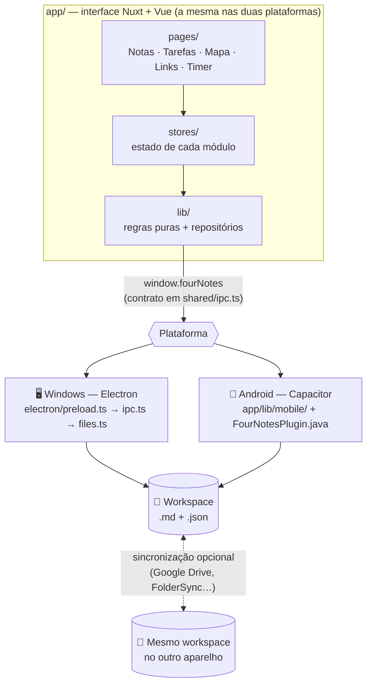

<div align="center">


# 4notes

**Notas, tarefas, mapas mentais, links e timer num só app — 100% local, no computador e no celular.**


[Recursos](#recursos) ·
[Arquitetura](#arquitetura) ·
[Começando](#comecando) ·
[Builds](#builds) ·
[Celular](#celular) ·
[Atalhos](#atalhos) ·
[Arquitetura detalhada](docs/ARQUITETURA.md)

</div>

---

## 💡 Sobre

O 4notes é um aplicativo pessoal de organização inspirado no Bloco de Notas do Windows, no Obsidian, no Capacities e no Notion. Ele junta, numa interface só, as coisas que costumam ficar espalhadas por vários apps: anotações rápidas, tarefas recorrentes, mapas de ideias, links salvos e o registro do tempo dedicado a cada atividade.

O que o diferencia:

- **Seus dados são arquivos seus.** Sem login, sem servidor, sem banco de dados. Tudo fica num **workspace** — uma pasta que você cria e nomeia — em **Markdown** (`.md`) e **JSON**. Backup é copiar a pasta; os arquivos abrem no VS Code, no Obsidian ou no Bloco de Notas.
- **Um editor que esconde o Markdown.** Você vê só o texto formatado — títulos, listas, checklists, cores, blocos de código coloridos, imagens — e nunca os `**`, `#` ou as cercas ` ``` `. O arquivo continua sendo Markdown comum.
- **A mesma interface no Windows e no Android.** O código da interface é um só; muda apenas a camada que fala com o sistema. Com a pasta sincronizada (Google Drive, por exemplo), notas, tarefas, mapas e configurações são os mesmos nos dois aparelhos.
- **Módulos ligados só onde faz sentido.** Cada módulo é independente; a única ligação entre eles são as **menções** (`@`), que funcionam entre todos.

---

<a id="recursos"></a>

## ✨ Recursos

### Os cinco módulos

| | Módulo | Em resumo |
| :-: | --- | --- |
| 📝 | **Notas** | Notas rápidas em abas, categorias com cor, ícone ou foto, pastas automáticas pelo título, navegação entre versões, exportação TXT/PDF. |
| ✅ | **Tarefas** | Categorias, datas, recorrência (que funciona com o app fechado), criação rápida e descrição com a mesma formatação das notas. |
| 🧠 | **Mapa Mental** | Vários mapas; cada nó é uma nota permanente. Conexões por arraste, seleção de várias notas e um "Reorganizar" que evita cruzamentos. |
| 🔗 | **Links** | Cole um endereço e o título e o ícone do site chegam sozinhos. Categorias, busca e importação dos favoritos do navegador. |
| ⏱️ | **Timer** | Cronômetro, temporizador e Pomodoro, com histórico filtrável e estatísticas com gráficos e comparação entre períodos. |

Os módulos podem ser **ativados, desativados e reordenados** (arrastando no menu lateral). Desativar só tira o módulo do menu: nenhum dado é apagado.

<details>
<summary><b>📝 Notas — detalhes</b></summary>

<br>

- **Abas compactas** com rolagem horizontal; a aba ativa leva a cor da categoria da nota.
- **Título automático**: a primeira linha é o título, e o nome do arquivo acompanha o título (`Ideias de jogo.md`).
- **Salvamento automático** 0,6 s depois da última tecla, com escrita atômica — também ao fechar a aba, com `Ctrl+S` e ao fechar o app.
- **Categorias** são pastas dentro de `notes/`, com cor, um ícone pronto ou uma foto da biblioteca de imagens. Mova notas pelo menu de contexto ou arrastando.
- **Pastas pelo título** (só na lista; os arquivos não mudam): `4notes 1.1.1` e `4notes 1.2.0` aparecem como **4notes › 1.1.1, 1.2.0**. O **+** de uma pasta cria uma nota que já começa com o título dela.
- **Categoria automática pelo título** (opcional, desligada por padrão): uma nota nova vai sozinha para a categoria que já tem notas com o mesmo começo de título.
- **Versões**: numa nota como `4notes 1.4.1`, botões discretos abrem a versão anterior (**‹ 1.4.0**) e a próxima (**1.4.2 ›**), quando existem.
- **Exportar** pelo menu de contexto: **TXT** (só o texto, sem formatação) ou **PDF** (como aparece na tela, com imagens e código colorido).
- Notas **sem categoria** perguntam ao fechar a aba se você quer guardá-las ou apagá-las; as que estão numa categoria fecham direto, já salvas.

</details>

<details>
<summary><b>✅ Tarefas — detalhes</b></summary>

<br>

- **Criação rápida**: `Estudar Godot amanhã #estudos` já define a data e a categoria.
- **Recorrência**: diária, semanal, a cada N dias/semanas/meses/anos, contando a partir da data programada ou da conclusão. A tarefa guarda só a regra e a próxima data — por isso funciona com o app fechado, sem processo em segundo plano.
- Ao concluir, a próxima ocorrência é calculada a partir de hoje (as perdidas são puladas); também dá para **pular** uma ocorrência.
- Listas de **Pendentes** (Hoje e Atrasadas), **Agendadas** e **Concluídas**.
- **Descrição formatada** com o mesmo editor das notas: negrito, listas, checklists, código, imagens coladas e menções.
- O painel de edição fecha ao clicar fora (sem perder o rascunho de uma tarefa nova).

</details>

<details>
<summary><b>🧠 Mapa Mental — detalhes</b></summary>

<br>

- **Vários mapas**, cada um numa pasta com uma nota `.md` por nó e um `mapa.json` com as conexões e as cores.
- Nós em **cards** (padrão) ou **círculos**, no estilo do Graph View do Obsidian; desenho em `<canvas>`, leve mesmo com centenas de nós.
- **Arrastar** move a nota; **Shift + arrastar** cria uma conexão; soltar a seta **no vazio** cria uma nota nova já conectada.
- **Seleção de várias notas**: `Ctrl + arrastar` seleciona uma área e `Ctrl + clique` põe ou tira uma nota. Mova, pinte ou exclua o grupo de uma vez, com um único **Desfazer**.
- **Reorganizar o mapa**: layout radial que minimiza cruzamentos, encurta as conexões e mantém o mapa compacto.
- No toque: pinça para zoom, uma alça com seta para conectar sem Shift e toque prolongado para o menu.

</details>

<details>
<summary><b>🔗 Links — detalhes</b></summary>

<br>

- **Salvar** colando no campo do topo, com `Ctrl+V` em qualquer lugar da tela ou arrastando um link do navegador. Links repetidos são detectados pela URL.
- **Título e ícone** buscados automaticamente e guardados em `links/icons/`, para aparecerem sem internet.
- **Categorias** com cor, ícone ou foto; ordenação por **Recentes**, **A–Z** ou **URL**.
- **Importar do navegador**: Brave, Opera GX, Opera, Chrome, Edge, Vivaldi, **Firefox** e **Zen** são encontrados automaticamente (um item por perfil). Outros navegadores: arquivo HTML de favoritos. Nada é alterado no navegador.
- Lista preparada para milhares de links (testada com 3.000).

</details>

<details>
<summary><b>⏱️ Timer — detalhes</b></summary>

<br>

- **Cronômetro**, **temporizador** (durações prontas ou `40`, `1:30`, `2h`) e **Pomodoro** com foco, pausa curta, pausa longa e início automático configuráveis.
- **Categoria e atividade** opcionais (ex.: categoria _Estudo_, atividade _Estudando Godot_); atividades recentes recomeçam com um clique.
- **A contagem vem do relógio**, não de um contador na tela: trocar de módulo, minimizar ou fechar o app não atrapalha. Um temporizador que termina com o app fechado é registrado no horário certo.
- **Histórico** com período, busca, filtros, agrupamento e edição do tempo válido. Sessões concluídas, interrompidas e canceladas são diferenciadas.
- **Estatísticas** só com dados reais: tempo por dia, categoria e atividade, rosca de distribuição, mapa de calor dias × horas e **comparação com o período anterior** (com o período em andamento, compara o mesmo trecho dos dois).
- Gráficos próprios em SVG, sem biblioteca externa, legíveis no claro, no escuro e no celular.

</details>

### Recursos que valem para o app inteiro

| | Recurso | Descrição |
| :-: | --- | --- |
| ✍️ | **Editor visual de Markdown** | Barra de formatação ao selecionar texto; listas que se renumeram; checklists clicáveis; blocos de código com linguagem detectada ao colar; blocos de texto; imagens coladas; `Ctrl+D` para editar várias ocorrências. |
| 🔁 | **Menções (`@`)** | Notas e tarefas mencionam notas, mapas, tarefas, links salvos e registros do Timer. Um clique abre o item no módulo dele; renomear no app corrige as menções. |
| 🖼️ | **Biblioteca de imagens** | Toda imagem enviada fica em `attachments/` para ser reutilizada em notas, tarefas e categorias, sem cópias repetidas. |
| 🗂️ | **Workspaces** | Crie quantos quiser, cada um com seus dados e configurações. O nome do workspace aparece no canto superior esquerdo. |
| 🎓 | **Tutoriais** | `F1` (ou o **?** do menu lateral) abre um painel com o propósito, os recursos, o menu de contexto e os atalhos de cada módulo. |
| 🌗 | **Tema claro e escuro** | Em roxo e amarelo, também nos menus de contexto. Animações respeitam o "reduzir movimento" do sistema. |
| 🔄 | **Atualizações automáticas** | Ao abrir, o app procura uma versão nova no GitHub Releases e instala com um clique (Windows e Android). |
| 🚀 | **Iniciar com o computador** | Opcional, no app instalado. |

---

## 🧰 Tecnologias

| Camada | Tecnologia | Uso no projeto |
| --- | --- | --- |
| Interface | **Nuxt 4** (SPA, `ssr: false`) + **Vue 3** | Telas, componentes, rotas por arquivo e estado com `reactive()` (sem Pinia). |
| Editor | **CodeMirror 6** + `@codemirror/language-data` | Editor de Markdown com formatação ao vivo e cores para dezenas de linguagens. |
| Desktop | **Electron 44** + **electron-builder** | Janela nativa, acesso a arquivos via IPC e instalador NSIS para Windows. |
| Celular | **Capacitor 8** | App Android com a mesma interface num WebView e um plugin nativo pequeno em Java. |
| Atualizações | **electron-updater** + GitHub Releases | Atualização do Windows; o Android usa a API do GitHub e um plugin próprio. |
| Build | **esbuild** | Compila o processo principal e o preload do Electron. |
| Qualidade | **TypeScript** (estrito) + **Vitest** | Tipagem da interface e do Electron e testes unitários das regras puras. |

Não há bibliotecas de UI, de ícones, de gráficos nem de CSS: os estilos usam variáveis CSS (`app/assets/css/tokens.css`) e os ícones e gráficos são SVG próprios.

---

<a id="arquitetura"></a>

## 🏗️ Arquitetura

A interface (`app/`) não sabe em que plataforma está. Ela conversa com uma única API — `window.fourNotes`, definida em [`shared/ipc.ts`](shared/ipc.ts) — que o **Electron** oferece no Windows e a camada **`app/lib/mobile/`** oferece no Android.



Princípios que guiam o código:

- **A interface nunca acessa o disco diretamente.** No desktop, `contextIsolation` e `sandbox` estão ligados; todo caminho é relativo ao workspace e validado (nada de `../`).
- **Escrita atômica**: o conteúdo vai para um arquivo temporário e só então substitui o original — uma queda de energia não corrompe nada.
- **Excluir manda para a Lixeira** do Windows (no Android, para `.4notes/trash/`), sempre com **Desfazer**.
- **Módulos independentes**: cada um tem seu store, repositório e pasta. A ponte de menções (`app/stores/mentions.ts`) é a única ligação entre eles.
- **Configurações no workspace, estado da tela no aparelho**: tema, módulos e ajustes ficam em `.4notes/settings.json` (iguais em todos os aparelhos); abas abertas e último módulo ficam em cada aparelho.

> 📘 A explicação completa — protocolos `app://` e `workspace://`, recorrência, menções, layout do mapa, Timer, Android e atualizações — está em **[docs/ARQUITETURA.md](docs/ARQUITETURA.md)**.

---

## 📁 Seus dados

Um workspace é uma pasta comum. O nome dele é o nome da pasta:

```text
Pessoal/                      ← o workspace
├── notes/                    Notas rápidas — um .md por nota
│   ├── Ideias de jogo.md
│   ├── categorias.json       ordem, cor, ícone e imagem das categorias
│   └── Trabalho/             uma pasta por categoria
├── tasks/tasks.json          tarefas e categorias
├── mindmap/
│   └── Principal/            uma pasta por mapa
│       ├── mapa.json         conexões e cores
│       └── Godot.md          um .md por nó
├── links/
│   ├── links.json            links e categorias
│   └── icons/                ícones dos sites
├── timer/timer.json          categorias, histórico e sessão em andamento
├── attachments/              biblioteca de imagens
└── .4notes/                  settings.json, posições dos nós e backups
```

| Conteúdo | Formato | Por quê |
| --- | --- | --- |
| Notas e nós do mapa | Markdown (`.md`) | Texto puro, compatível com Obsidian e VS Code. |
| Categorias das Notas | Pastas + `categorias.json` | A categoria aparece igual no Explorador de Arquivos. |
| Tarefas, links, Timer, conexões do mapa | JSON | Dados estruturados, ainda editáveis à mão. |
| Imagens | Arquivos em `attachments/` + caminho relativo | Vão junto no backup e aparecem em outros editores. |
| Configurações | `.4notes/settings.json` | Valem para o workspace, em todos os aparelhos. |

Tarefas, links e o Timer ganham **uma cópia por dia da semana** em `.4notes/backups/`. Se um desses arquivos for editado à mão e ficar inválido, o app avisa e **não sobrescreve nada**.

A formatação continua sendo Markdown comum: `# título`, `- lista`, `- [ ] tarefa`, `**negrito**`, `==marca-texto==`, ` ```linguagem `. Sublinhado e cor usam HTML simples (`<u>…</u>`, `<span style="color: red">…</span>`), que o Obsidian também entende.

---

<a id="comecando"></a>

## 🚀 Começando

### Pré-requisitos

| Requisito | Para quê |
| --- | --- |
| **Node.js 22.12+** (confira com `node -v`) | Desenvolver e gerar qualquer versão. |
| Windows 10/11 | Plataforma principal do desktop (o Electron também roda em macOS e Linux). |
| **[Android Studio](https://developer.android.com/studio)** | Só para gerar o app Android (traz o Java e o Android SDK). O app roda no Android 7 ou mais recente. |

### Instalação e modo de desenvolvimento

```bash
npm install      # instala as dependências e baixa o Electron (só na primeira vez)
npm run dev      # abre o 4notes com recarregamento automático
```

O `npm run dev` ([`scripts/dev.mjs`](scripts/dev.mjs)) sobe o Nuxt em `http://127.0.0.1:3141`, compila o Electron com o esbuild em modo _watch_ e abre a janela:

- mudou algo em `app/`? A janela atualiza sozinha;
- mudou algo em `electron/`? O Electron reinicia sozinho;
- `F12` abre as ferramentas de desenvolvedor.

Na primeira abertura, escolha **Criar workspace** (você escolhe o local e o nome) ou **Abrir workspace existente**.

### Scripts disponíveis

| Comando | O que faz |
| --- | --- |
| `npm run dev` | Desenvolvimento (Nuxt + Electron com recarregamento). |
| `npm start` | Compila e abre a versão de produção sem instalar. |
| `npm run build` | Gera a interface (`.output/public`) e compila o Electron (`dist-electron/`). |
| `npm run build:web` | Só a interface, usada pelo Windows e pelo Android. |
| `npm run build:windows` | Instalador do Windows (o mesmo que `npm run dist:win`). |
| `npm run dist` | Instalador para o sistema atual (`dist:mac` e `dist:linux` também existem). |
| `npm run build:android` | APK do Android em `release/android/4notes-<versão>.apk`. |
| `npm run android:run` | Gera e instala no celular conectado por cabo (depuração USB). |
| `npm run android:sync` | Só atualiza o projeto `android/` com a interface. |
| `npm run android:open` | Abre o projeto `android/` no Android Studio. |
| `npm run build:ios` | Explica o que falta para o iOS (ainda não incluído). |
| `npm run release` | Publica a versão no GitHub Releases (Windows + Android). |
| `npm test` | Testes unitários (Vitest). |
| `npm run typecheck` | Verificação de tipos da interface e do Electron. |

---

<a id="builds"></a>

## 📦 Gerando as versões

O número da versão fica no campo `"version"` do `package.json` e vale para o Windows e para o Android. Aumente-o antes de gerar uma atualização.


### 🖥️ Windows

```bash
npm run build:windows
```

O instalador fica em `release/<versão>/4notes-Setup-<versão>.exe`. Ele instala só para o seu usuário (sem pedir administrador), permite escolher a pasta e pergunta se você quer um atalho na área de trabalho ([`build/installer.nsh`](build/installer.nsh)). Desinstalar **nunca** apaga os workspaces.

> [!NOTE]
> O instalador não é assinado digitalmente. Se o Windows mostrar _"O Windows protegeu o computador"_, clique em **Mais informações → Executar assim mesmo**.

### 📱 Android

1. Instale o Android Studio e abra-o uma vez: o assistente baixa o Android SDK.
2. Rode:

   ```bash
   npm run build:android
   ```

3. O APK fica em `release/android/4notes-<versão>.apk`. A primeira compilação demora alguns minutos (o Gradle baixa o que precisa).

O script [`scripts/android.mjs`](scripts/android.mjs) encontra sozinho um Java compatível com o Gradle (17 a 24) e o Android SDK — ou usa `JAVA_HOME` e `ANDROID_HOME`.

- **Assinatura**: com `android/keystore.properties` (fora do Git), o APK usa a sua chave; sem ele, a chave de testes do Android Studio do computador. O Android só atualiza um app com um APK assinado pela **mesma chave**.
- **Versão**: `1.6.2` vira o `versionCode` 10602.

### 🍎 iOS

Ainda não incluído. O mesmo código serviria (Capacitor), mas o build exige um Mac com o Xcode, e o iOS não permite usar uma pasta qualquer como workspace. `npm run build:ios` explica os passos.

---

## 🔄 Atualizações automáticas

Ao abrir, o 4notes procura uma versão nova no **GitHub Releases**. Se encontrar, pergunta se você quer instalar: no Windows, o app fecha, atualiza e abre de novo; no Android, abre o instalador do sistema. **Agora não** guarda a versão em **Configurações › Geral › Atualizações**. Atualizar nunca mexe nos dados do workspace. Com `npm run dev`, a procura fica desligada.

<details>
<summary><b>Preparar a publicação (uma vez só)</b></summary>

<br>

1. **Repositório público para as versões.** Crie no GitHub um repositório **público** só para os instaladores, com pelo menos um commit (marque _"Add a README file"_). O código do 4notes pode continuar privado.
2. **Aponte o 4notes para ele** no `package.json`:

   ```json
   "updates": {
     "github": "seu-usuario/seu-repositorio"
   }
   ```

3. **Token para publicar.** Em GitHub → _Settings_ → _Developer settings_ → _Fine-grained tokens_, crie um token só para esse repositório com **Contents: Read and write** e coloque-o no arquivo `.env` na raiz do projeto (ignorado pelo Git):

   ```bash
   GH_TOKEN=github_pat_...
   ```

4. **Chave fixa do Android** em `android/keystore.properties` (também fora do Git):

   ```properties
   storeFile=4notes.keystore
   storePassword=...
   keyAlias=...
   keyPassword=...
   ```

   Para continuar atualizando o APK que já está no celular, use a mesma chave com que ele foi assinado (por exemplo, uma cópia de `%USERPROFILE%\.android\debug.keystore`, senhas `android` e alias `androiddebugkey`). Guarde uma cópia da chave em lugar seguro.

5. `npm install`.

</details>

<details>
<summary><b>Publicar uma versão</b></summary>

<br>

1. Aumente o `"version"` do `package.json`.
2. (Opcional) descreva as novidades em `release-notes.md` — o texto aparece na pergunta de atualização.
3. Publique:

   ```bash
   npm run release                         # Windows + Android
   npm run release -- --windows            # só o Windows
   npm run release -- --android            # só o Android (acrescenta o APK a uma versão já publicada)
   npm run release -- --notes "Correções"  # notas na linha de comando (ou --notes-file arquivo.md)
   npm run release -- --draft              # deixa como rascunho no GitHub
   ```

O [`scripts/release.mjs`](scripts/release.mjs) confere o repositório, o token e a chave; gera o `.exe` e o APK; cria o Release `v<versão>` como rascunho, envia `4notes-Setup-<versão>.exe`, `latest.yml` e `4notes-<versão>.apk` e só então publica — os apps nunca veem uma versão pela metade. Ele não republica uma versão existente. Outras opções: `--skip-build` (usa os arquivos já gerados) e `--allow-debug-key`.

> [!IMPORTANT]
> Versões anteriores à 1.6.2 não sabem procurar atualizações: a 1.6.2 precisa ser instalada à mão uma vez.

</details>

---

<a id="celular"></a>

## 📱 Celular e sincronização

**Instalar**: passe o `.apk` para o celular e toque nele (permita _"instalar apps desconhecidos"_ para o app que abriu o arquivo). Na primeira abertura, o 4notes pede o **Acesso a todos os arquivos**: é ele que permite manter o workspace numa pasta escolhida por você, visível para apps de sincronização.

**Adaptado a cada tela**, incluindo o Galaxy Z Fold:

| Tamanho | Exemplos | Como fica |
| --- | --- | --- |
| `compact` | Celular em pé, tela externa do Fold | Uma coisa por vez, módulos na barra de baixo, menus em folhas que sobem de baixo. |
| `medium` | Tela interna do Fold, celular deitado | Menu lateral, lista e conteúdo lado a lado. |
| `expanded` | Tablet, computador | O layout do desktop. |

Girar a tela ou abrir e fechar o dobrável só reorganiza a interface — nada se perde. No toque, **segurar o dedo** faz o papel do botão direito e o **voltar** do Android fecha o que estiver aberto.

<details>
<summary><b>Usar o mesmo workspace no computador e no celular</b></summary>

<br>

O 4notes **não sincroniza** sozinho e não usa nenhum servidor: ele lê e grava uma pasta, e um app de sincronização a mantém igual nos dois aparelhos.

1. **No computador**: instale o Google Drive para computador no modo **Espelhar arquivos** e coloque o workspace dentro do "Meu Drive".
2. **No celular**: o app do Google Drive não sincroniza pastas — use um app de sincronização em duas vias, como o **Autosync** ou o **FolderSync**, ligando uma pasta do celular à pasta do Drive.
3. No 4notes do celular: **Abrir workspace existente** e escolha a pasta sincronizada.
4. Confira se a pasta oculta `.4notes/` também é sincronizada (é nela que ficam as configurações).

**Iguais nos dois aparelhos**: notas, tarefas, mapas (com as posições dos nós), links, Timer, imagens e configurações. **De cada aparelho**: abas abertas, último módulo e mapa aberto. O app relê os arquivos ao voltar para ele e a cada minuto. Use um aparelho de cada vez para evitar conflitos.

**Diferenças no Android**: excluir vai para `.4notes/trash/`; o PDF sai pela impressão do sistema; a importação de links aceita o arquivo HTML de favoritos; não existem "Mostrar no Explorador" nem "Iniciar com o computador".

</details>

---

<a id="atalhos"></a>

## ⌨️ Atalhos

Os atalhos de cada módulo também estão no tutorial (`F1`). No macOS, `Ctrl` vira `⌘`.

<details open>
<summary><b>Gerais</b></summary>

<br>

| Atalho | Ação |
| --- | --- |
| `Ctrl+1` … `Ctrl+5` | Notas / Tarefas / Mapa Mental / Links / Timer |
| `Ctrl+N` | Novo item no módulo atual |
| `Ctrl+,` | Configurações |
| `F1` | Tutorial do módulo atual |
| `Ctrl++` / `Ctrl+-` / `Ctrl+0` | Zoom da interface |

</details>

<details>
<summary><b>Notas e editor</b></summary>

<br>

| Atalho | Ação |
| --- | --- |
| `Ctrl+W` | Fechar a aba |
| `Ctrl+Tab` / `Ctrl+Shift+Tab` | Próxima / anterior aba |
| `Ctrl+Shift+T` | Reabrir a aba fechada |
| `Ctrl+\` | Mostrar/ocultar a lista de notas |
| `Ctrl+F` | Procurar na nota |
| `Ctrl+D` | Selecionar também a próxima ocorrência (edita todas juntas) |
| `Ctrl+B` / `Ctrl+I` / `Ctrl+U` | Negrito / itálico / sublinhado |
| `Ctrl+Shift+X` / `Ctrl+Shift+H` | Tachado / marca-texto |
| `Ctrl+E` | Código na linha |
| `Ctrl+K` | Link no texto selecionado |
| `Ctrl+Shift+V` | Colar sem formatação (código não vira bloco) |
| `Ctrl+clique` | Abrir o link no navegador |
| `@` | Mencionar uma nota, mapa, tarefa, link ou registro do Timer |

Os atalhos do Markdown funcionam no começo da linha: `# `, `- `, `1. `, `- [ ] `, `> ` e ` ``` ` + `Enter`.

</details>

<details>
<summary><b>Tarefas, Mapa Mental, Links e Timer</b></summary>

<br>

| Módulo | Atalho | Ação |
| --- | --- | --- |
| Tarefas | `Enter` / `Espaço` | Abrir / concluir a tarefa selecionada |
| Tarefas | `Esc` | Fechar o painel |
| Mapa | `Ctrl+K` | Buscar no mapa |
| Mapa | `Shift` + arrastar | Conectar notas (soltar no vazio cria uma nota) |
| Mapa | `Ctrl` + arrastar / `Ctrl` + clique | Selecionar por área / pôr ou tirar da seleção |
| Mapa | `Delete` | Excluir as notas ou a conexão selecionadas |
| Mapa | `Esc` | Fechar a nota / tirar a seleção |
| Links | `Ctrl+V` | Salvar o endereço copiado |
| Links | `↑` `↓` / `Enter` / `F2` / `Delete` | Escolher / abrir / editar / excluir |
| Links | `Ctrl+C` | Copiar o endereço |
| Timer | `Espaço` | Iniciar, pausar ou retomar |
| Timer | `Ctrl+Enter` | Finalizar a sessão |
| Timer | `←` / `→` | Período anterior / próximo |

</details>

---

## 🧪 Testes

```bash
npm test             # testes unitários (Vitest)
npm run typecheck    # TypeScript estrito na interface e no Electron
```

Os testes ficam em [`tests/`](tests/) (23 arquivos) e cobrem as regras puras, sem Vue e sem disco: datas e recorrência, títulos e nomes de arquivo, formatação e Markdown escondido, listas, detecção de código, blocos de texto e `Ctrl+D`, categorias e pastas pelo título, versões das notas, exportação, menções entre módulos, mapa (grafo e layout), links e favoritos de navegadores (Chromium, Firefox/Zen, HTML), biblioteca de imagens, módulos, configurações sincronizadas, a camada Android sobre um disco em memória, tamanhos de tela, Timer (em vários fusos) e atualizações.

---

## 🗺️ Estrutura do projeto

```text
4notes/
├── app/                    Interface (Nuxt 4 + Vue 3) — a mesma no Windows e no Android
│   ├── pages/              Um arquivo por módulo: notes, tasks, mindmap, links, timer
│   ├── components/         editor/, notes/, tasks/, mindmap/, links/, timer/, shell/, ui/
│   ├── stores/             Estado de cada módulo + mentions.ts (a ponte entre módulos)
│   ├── lib/                Regras puras e persistência; lib/mobile/ é a camada do Android
│   ├── composables/        Tema, atalhos, layout por tamanho de tela, diálogos…
│   ├── plugins/            Tema, plataforma e animação de clique nos ícones
│   └── assets/css/         Cores (tokens.css), estilos base e mobile.css
├── electron/               Processo principal: janela, IPC, arquivos, workspaces, links, export, updates
├── shared/                 Contrato da API (ipc.ts) e regras usadas pelas duas plataformas
├── android/                Projeto Android (Capacitor) + plugins nativos em Java
├── scripts/                dev, build-electron, android, ios e release
├── tests/                  Testes unitários (Vitest)
├── build/                  Ícones e script do instalador (installer.nsh)
├── docs/ARQUITETURA.md     Documentação técnica detalhada
├── capacitor.config.ts     Configuração do app Android
├── electron-builder.yml    Configuração do instalador
└── nuxt.config.ts          Configuração do Nuxt (SPA)
```

Para saber **onde mexer** em cada funcionalidade, veja a tabela no fim de [docs/ARQUITETURA.md](docs/ARQUITETURA.md).

---

## 🩺 Problemas comuns

<details>
<summary><b><code>npm install</code> falha com <code>EPERM</code>/<code>EBUSY</code> dentro do OneDrive</b></summary>

<br>

O OneDrive pode travar arquivos de `node_modules` durante a sincronização. Pause a sincronização durante a instalação ou mantenha o **código-fonte** fora do OneDrive (ex.: `C:\dev\4notes`). O workspace com os dados pode ficar no OneDrive sem problema.

</details>

<details>
<summary><b>Tarefas, links ou o Timer não carregam</b></summary>

<br>

O `tasks.json`, o `links.json` ou o `timer.json` foi editado e ficou com JSON inválido. O app não sobrescreve nada: corrija o arquivo ou restaure uma cópia de `.4notes/backups/`.

</details>

<details>
<summary><b>O <code>build:android</code> não encontra o Java ou o Android SDK</b></summary>

<br>

Abra o Android Studio uma vez e deixe o assistente terminar. Se ele estiver instalado num lugar diferente do padrão, configure `JAVA_HOME` (a pasta `jbr` do Android Studio) e `ANDROID_HOME` (a pasta do SDK). Um erro `Unsupported class file major version 69` significa Java 25 ou mais novo: instale um JDK entre 17 e 24 (o script escolhe sozinho um compatível quando existe).

</details>

<details>
<summary><b>"App não instalado" ao atualizar no celular</b></summary>

<br>

O APK novo foi assinado com outra chave ou tem uma versão menor que a instalada. Gere com a mesma chave (`android/keystore.properties`) e aumente a versão no `package.json`. Se precisar desinstalar o app, o workspace não é apagado.

</details>

<details>
<summary><b>Uma mudança feita num aparelho não aparece no outro</b></summary>

<br>

Confira se o app de sincronização terminou e se ele sincroniza a pasta oculta `.4notes/`. O 4notes relê os arquivos quando você volta para ele.

</details>

<details>
<summary><b>Um link ficou sem ícone</b></summary>

<br>

O site estava fora do ar ou bloqueou o acesso. Use **Atualizar título e ícone** no botão direito do link; enquanto isso, ele aparece com a inicial do site.

</details>

<details>
<summary><b>Notas de migração entre versões</b></summary>

<br>

- **Vindo da 1.0.0**: na primeira abertura da 1.0.1, as notas do Mapa Mental vão para o mapa `Principal` e os `[[links]]` viram conexões no `mapa.json`. Uma cópia das notas originais fica em `.4notes/backups/mindmap-1.0.0-<data>/`.
- **Vindo da 1.4.3**: na primeira abertura da 1.5.0, as configurações passam para `.4notes/settings.json` e o estado da tela passa a ficar em cada aparelho. Os arquivos antigos vão para `.4notes/backups/1.5.0/`. Atualize todos os aparelhos que usam o workspace.

</details>

---

## 📄 Licença

Projeto pessoal de **Kauan**, sem licença de uso aberta (`"license": "UNLICENSED"` no `package.json`). Todos os direitos reservados.

<div align="center">
<br>

<br>
<sub>Feito com Nuxt, Electron e Capacitor — seus dados, sempre na sua pasta.</sub>
</div>
